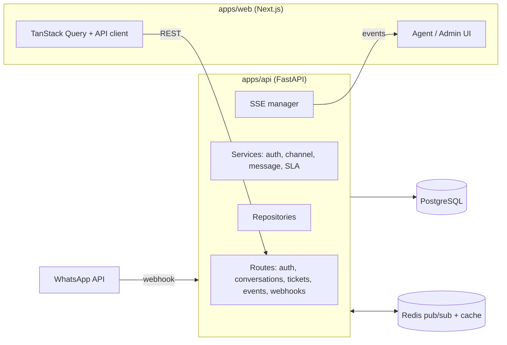

# GhitDesk — Omnichannel Helpdesk (MVP)

Helpdesk for small support teams: WhatsApp conversations land in a shared inbox, become tickets with SLA tracking, and update the agent UI in real time.

**Stack:** Next.js 15 · React 18 · TypeScript · HeroUI · TanStack Query · FastAPI · SQLAlchemy 2 (async) · PostgreSQL 16 · Redis 7 · Docker · GitHub Actions

---

## What it does

- **Shared inbox** — WhatsApp messages arrive through a webhook and are grouped into conversations per contact.
- **Tickets with SLA** — conversations can become tickets with priority, status and an SLA deadline calculated by a pluggable strategy.
- **Real-time updates** — new messages and ticket changes are pushed to the browser via Server-Sent Events (SSE), with Redis pub/sub behind it.
- **Auth** — JWT login with hashed passwords (bcrypt) and role-based screens for admins and agents.
- **Design system** — HeroUI base components plus custom GhitDesk components (StatusBadge, PriorityBadge, TicketCard…), documented in Storybook.

## Architecture



### Design patterns (and where to find them)

| Pattern | Where | Why |
|---|---|---|
| Factory | `apps/api/app/services/channel_service.py` (ChannelFactory) | Add a new channel (e-mail, Telegram) without touching existing handlers |
| Strategy | `apps/api/app/services/sla_service.py` (SimpleSLAStrategy, BusinessHoursSLAStrategy) | Swap SLA rules per account |
| Strategy | `apps/api/app/services/message_service.py` (WhatsApp / e-mail inbound) | Each channel parses inbound messages its own way |
| Repository | `apps/api/app/db/repositories/` | Keep SQL out of the services; easier to test |
| Singleton | `core/config.py`, `cache/redis_client.py`, `integrations/sse_manager.py`, `integrations/whatsapp_client.py` | One engine/connection pool per process |

## Project structure

```
apps/
  web/   Next.js App Router · components/ghitdesk · services (API + SSE client) · Storybook
  api/   FastAPI · core · db/repositories · models · schemas · services · integrations · migrations (Alembic) · tests
docs/    architecture notes, roadmap, security checklist
.github/workflows/ci.yml   lint · backend tests (Postgres + Redis services) · frontend tests · build
```

## Running locally

Requirements: Node 20+, pnpm 8+, Python 3.11+, Docker.

```bash
git clone https://github.com/ghitflux/app_ghitdesk.git && cd app_ghitdesk
pnpm install
cp .env.example .env.local          # adjust if needed
docker-compose up -d                # PostgreSQL + Redis

cd apps/api
python -m venv venv && source venv/bin/activate   # Windows: venv\Scripts\activate
pip install -r requirements.txt
alembic upgrade head
python seed_data.py                 # demo users and data
python -m app.main                  # API on http://localhost:8000 (docs at /docs)

cd ../.. && pnpm dev                # Web on http://localhost:3000
pnpm storybook                      # optional, http://localhost:6006
```

Demo users created by `seed_data.py` (local only): `admin@ghitdesk.com / admin123`, `joao@ghitdesk.com / agent123`.

## Tests and CI

```bash
cd apps/api && pytest --cov=app     # backend: channel factory, security, SLA service
pnpm --filter web test              # frontend (Vitest)
```

Every push and pull request runs lint, backend tests against real PostgreSQL and Redis containers, frontend tests and the production build (`.github/workflows/ci.yml`).

## Status and next steps

MVP: inbox, tickets, SLA, SSE and auth work end to end with WhatsApp as the first channel. Next on the list:

- e-mail channel end to end (the inbound strategy and factory slot already exist);
- business-hours SLA as the default for accounts with opening hours;
- multi-tenant isolation (one schema per organization);
- broader test coverage on routes and the web app.

## How it was built

Spec first, small diffs, human review before anything sensitive. I use AI coding assistants for scaffolding and tests, and every change goes through review and CI before merge (`CLAUDE.md` holds the project rules the assistant follows).

---

Hélcio Venâncio · [github.com/ghitflux](https://github.com/ghitflux)
